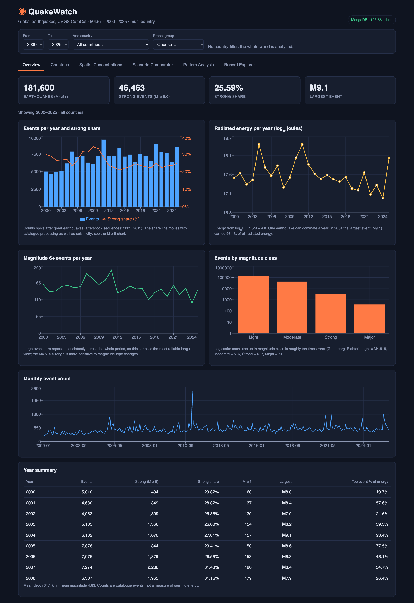
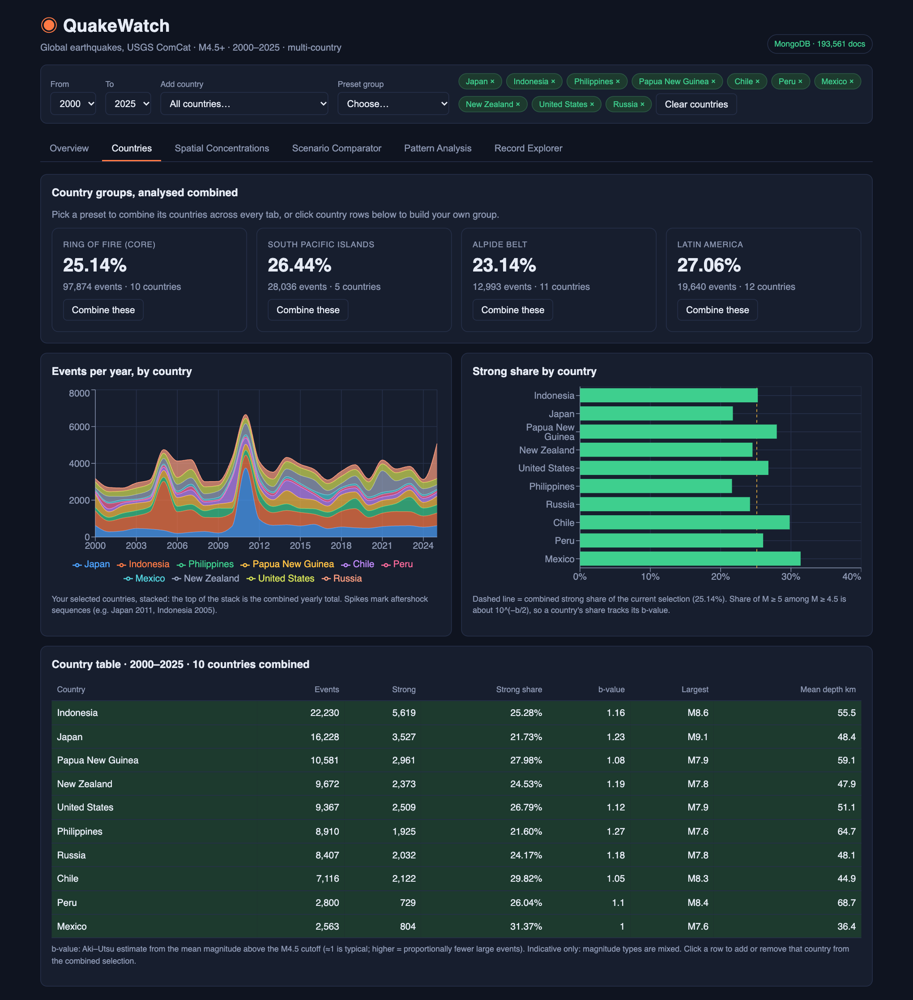
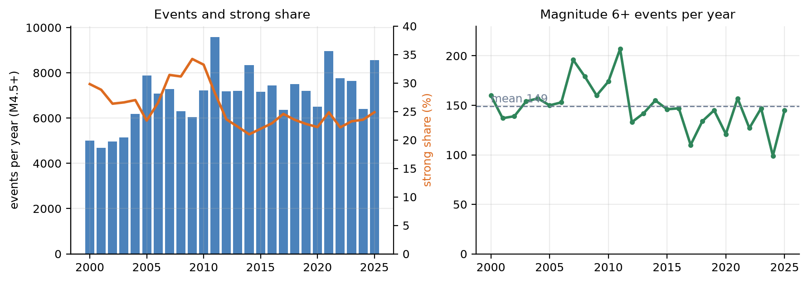
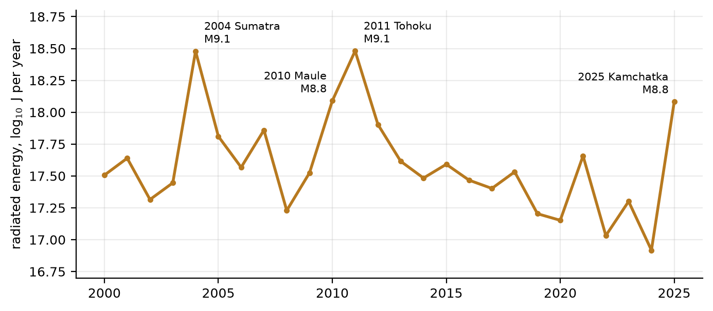
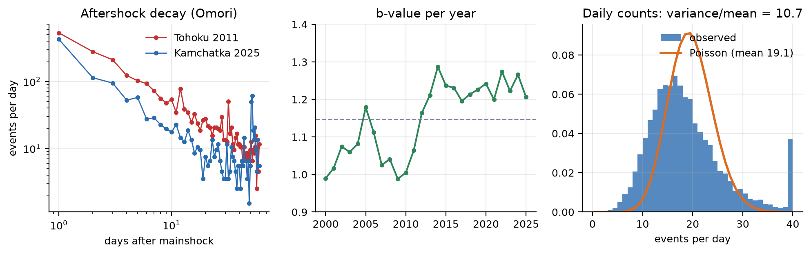
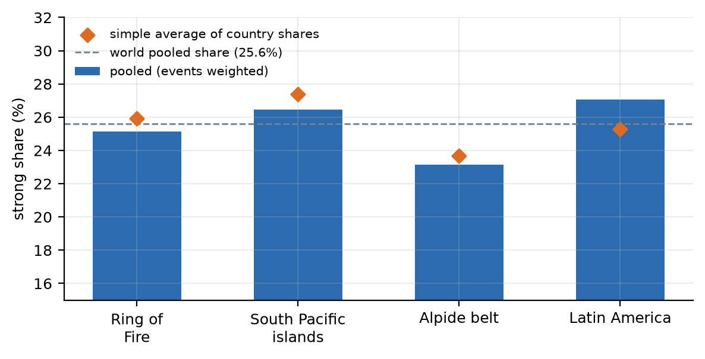
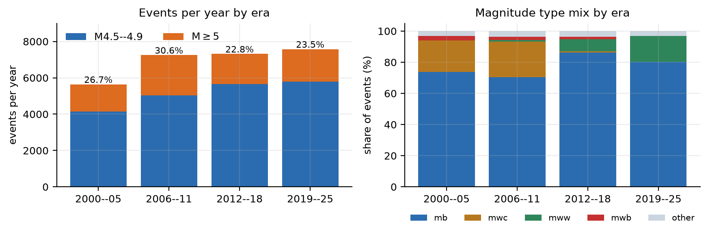

# QuakeWatch explained

A plain-language guide to the project: what we did, why, what we found, and how to explain it to someone else.
Code: https://github.com/vibhor-5/quakewatch-bdm · Full report: [`main.pdf`](main.pdf)

---

## 1. The project in one paragraph

We took **26 years of global earthquake records (2000–2025, 181,600 earthquakes of magnitude 4.5 or more)** from the US Geological Survey, cleaned them, worked out which **country** each one belongs to, and stored them in **MongoDB**. A **Flask API** answers questions about the data and a **React web app** shows the answers: maps, charts, tables and a record browser. The key feature is that you can pick **any set of countries and any range of years and see them combined**. The central question is: *what share of earthquakes are strong (magnitude 5 or more), and what does that share depend on?*

It is a Big Data Management project, so a large part of the work is the data side: ingestion, a schema, indexes, query benchmarks, and feeding both a web app and a BI dashboard from one source.

## 2. Words you need

| Term | Meaning |
|---|---|
| **USGS / ComCat** | The United States Geological Survey is a government science agency. ComCat is its public earthquake catalogue. Seismograph networks worldwide report to it and it publishes each event (time, place, depth, magnitude) through a free web API. We did not collect any data ourselves. |
| **Magnitude (M)** | The size of an earthquake. The scale is logarithmic: each +1 is about 10× more ground shaking and about 32× more energy. |
| **M4.5+** | Our cut-off. Below roughly M4.5 the world catalogue is incomplete, because small quakes are only picked up where there are dense local sensors. Using 4.5 makes countries comparable. |
| **Depth** | How far underground the quake starts. We group it as Shallow (<70 km), Intermediate (70–300 km) and Deep (>300 km). |
| **Strong** | An earthquake with M ≥ 5.0. |
| **Strong share** | `strong events ÷ all events` in a group, as a percentage. Overall: 46,463 ÷ 181,600 = **25.59%**. We use a share, not a count, so large groups and small groups can be compared fairly. |
| **Share ratio / odds ratio** | Compare a group with the world: a share ratio of 1.2 means a quake in that group is 1.2× as likely to be strong as an average quake. |
| **2° grid cell** | The Earth is cut into squares 2° of latitude by 2° of longitude (about 220 km wide). Each quake is put in one square so we can map where activity is concentrated. There are 3,524 non-empty cells. |
| **Aftershocks** | Smaller quakes that follow a big one near it, for days to months. They make counts jump after great earthquakes. |
| **Gutenberg–Richter law and b-value** | Quakes get about 10× rarer for each +1 in magnitude. The *b-value* measures how steep that fall-off is (about 1.0–1.3 here). A higher b means proportionally more small quakes. |
| **Radiated energy** | Estimated from magnitude with `log10 E = 1.5·M + 4.8` (joules). |
| **Pooled share** | When countries are combined, we add up their strong events and all events, then divide. We do **not** average their percentages, because that would give a tiny country the same weight as a huge one. |

## 3. How the pipeline works

```
USGS API ─▶ download ─▶ prepare ─▶ import ─▶ MongoDB ─▶ Flask API ─▶ React web app
                           │
                           └─▶ export ─▶ CSV tables ─▶ Plotly dashboard / Power BI
```

1. **Download** (`download_data.py`): 312 requests, one per month. Each file is saved with a manifest recording its URL, time and SHA-256 hash, so the data can be audited and re-created.
2. **Prepare** (`prepare.py`, `countries.py`):
   * Keep real earthquakes only. 82 rows were removed (71 volcanic eruptions, 5 nuclear explosions, 2 explosions, 2 landslides, 1 rock burst, 1 mine collapse). One earthquake whose magnitude had been revised below 4.5 was dropped too. **181,600 remain.**
   * Convert times to UTC and derive year, month, hour and weekday.
   * Add depth class, magnitude class, the 2° grid cell and radiated energy.
   * **Attribute a country.** USGS writes the place as "12 km N of Ridgecrest, California" or "Fiji region". We take the text after the last comma, match it against a list of country names, fold US states into the United States, and fold a few territories into their country (Kuril Islands → Russia, Kermadec Islands → New Zealand). Anything on an ocean ridge or in open sea is labelled **Ocean / Unassigned** (13.0% of events). This gives **154 countries**.
3. **Import** (`import_data.py`): load three collections and build indexes.
4. **Export** (`export_bi.py`): write a star schema of seven CSV files for the dashboard and Power BI.

## 4. The MongoDB design

| Collection | One document per | Documents |
|---|---|---|
| `earthquakes` | earthquake (the USGS event id is the `_id`) | 181,600 |
| `daily_summary` | date | 9,497 |
| `country_summary` | country and year | 2,464 |

Indexes on `earthquakes` match the questions we ask: year + strong flag, date + strong flag, grid cell + year, magnitude, country + year, country + strong flag, plus a **2dsphere index** on the GeoJSON location for "within X km" queries.

**Benchmark** (MongoDB `explain`, median of 5 runs, with the index versus a forced collection scan):

| Query | Documents examined: index → scan | Time: index → scan |
|---|---|---|
| 2011 strong events | 2,701 → 181,600 (67× fewer) | 1 ms → 52 ms |
| Japan strong events | 3,527 → 181,600 (51× fewer) | 1 ms → 53 ms |
| Within 300 km of Tokyo | 4,797 → 181,600 (38× fewer) | 6 ms → 142 ms |
| Magnitude ≥ 6 | 3,874 → 181,600 (47× fewer) | 2 ms → 46 ms |
| Single event by id | 1 → 181,600 | 0 ms → 42 ms |

Say it this way: *the useful evidence is the number of documents examined. Millisecond timings this small are near the timer's resolution, and 181k documents is still a small dataset.*

## 5. The API

Thirteen endpoints, each a MongoDB aggregation pipeline. Every one accepts the same filters: `year_from`, `year_to` and `countries` (a comma-separated list). That is how "combine several countries" works across the whole app.

`overview`, `temporal`, `conditions`, `hotspots`, `countries`, `trends`, `groups`, `compare`, `combinations`, `options`, `events`, `events/<id>`, `health`.

Thirteen automated tests check, among other things, that selecting Japan and Chile equals Japan plus Chile, that year ranges partition the total, and that the b-value and strong share agree.

## 6. A tour of the web app

A **filter bar** sits above the tabs: year range, add-a-country, preset groups, and removable chips for the chosen countries. With no country chosen, the whole world is analysed.

| Tab | What you see |
|---|---|
| **Overview** | Headline numbers, events per year with strong share, radiated energy per year, M6+ events per year, a monthly series and a year-by-year table. |
| **Countries** | Four preset groups (Ring of Fire, South Pacific islands, Alpide belt, Latin America), stacked events per year, strong share per country, and a table with b-values. Click a row to add or remove a country. |
| **Spatial Concentrations** | A Leaflet map of the 2° cells: size is event count, colour is strong share. |
| **Scenario Comparator** | Put two scenarios side by side (for example Japan vs Chile) and see each strong share and the ratio between them. |
| **Pattern Analysis** | Strong share by depth and magnitude type, hour of day, weekday, and the most active countries. |
| **Record Explorer** | Search and page through events. Opening one shows the stored document and a geospatial query for other events within 150 km and one day. |




## 7. What we found

### Volume and energy
* About **7,000 events a year** on average (4,680 in 2001 up to 9,584 in 2011). **3,874** are M6+ (99–207 a year) and **387** are M7+.
* **Four earthquakes carry 48% of all the energy** released in 26 years: Sumatra 2004 (M9.1), Tohoku 2011 (M9.1), Maule, Chile 2010 (M8.8) and Kamchatka 2025 (M8.8). In 2004 and 2011 a single quake carried over 93% of that year's energy. 2025 had 14.6× the energy of 2024 although it had only 34% more events.




### Patterns
* **Earthquakes arrive in bursts, not at random.** If they were independent, the variance of daily counts would equal the mean. It is **10.7× the mean**. The busiest day (11 March 2011) had 454 events, and the busiest 10% of days hold 23% of all events.
* **Aftershocks decay along a straight line on log–log axes (the Omori law).** After Tohoku, Japan recorded 531 events in the first day and 13 on day 30.
* **The b-value is rising**, from about 1.04 in 2000–04 to about 1.23 in 2021–25: proportionally more small events.



### Countries
* **Indonesia (22,230), Japan (16,228) and Papua New Guinea (10,581)** have the most events. The top ten countries hold 59.3% of the catalogue.
* Strong share ranges from **19.5% (Fiji) to 31.4% (Mexico)** among the 23 countries with 1,000+ events.
* A country's strong share is almost a function of its b-value (correlation −0.99). Since a Gutenberg–Richter catalogue implies `strong share ≈ 10^(−b/2)`, the strong share is just another way of describing the slope of the magnitude distribution. *Caveat: both numbers come from the same events, so this agreement is partly built in.*
* Countries with very deep quakes (Fiji at 434 km mean depth, Argentina, Timor Leste) have the lowest shares, which fits deep quakes having a lower strong share (20.4%) than shallow ones (26.9%). We do not claim depth causes it.

### Combined countries

| Group | Events | Pooled strong share | Simple average of country shares |
|---|---|---|---|
| Ring of Fire (10 countries) | 97,874 | 25.14% | 25.93% |
| South Pacific islands (5) | 28,036 | 26.44% | 27.39% |
| Alpide belt (11) | 12,993 | 23.14% | 23.67% |
| Latin America (12) | 19,640 | 27.06% | 25.30% |

The pooled and averaged numbers differ, and for Latin America the gap is 1.8 points. This is why the app pools.



### Magnitude type is a trap
Events labelled `mww`, `mwc` or `mwb` are 86–100% strong; `mb` events are 11% strong. That does **not** mean one scale causes strong quakes. USGS computes moment magnitudes mainly for large events, so the label follows the size. It is a reporting effect.

### Strong share changed over time
Strong share was 26.7% (2000–05), 30.6% (2006–11), 22.8% (2012–18) and 23.5% (2019–25). Both parts moved: M6+ events per year went 150 → 178 → 138 → 134, and M4.5–4.9 events per year rose 4,136 → 5,034 → 5,648 → 5,797. The magnitude-type mix also changed around 2011. So the catalogue alone **cannot separate real seismicity from changes in processing**, and the M6+ count (complete in every year) is the safer long-run series.



## 8. What it cannot tell you
* It is **descriptive**: it describes a catalogue. It is not a hazard model and does not predict earthquakes.
* **Country attribution is a text heuristic.** Offshore quakes inherit the nearest named town's country, 13% have no country, and folding territories into countries is our choice.
* The **b-value** uses one cut-off for every country, mixed magnitude types and no uncertainty interval.
* **Era comparisons** of strong share are confounded by processing changes (see above).
* Grid cells are **not equal-area**; nearby-event lists are capped at 50 and are only candidate aftershocks.
* The Power BI `.pbix` was **not produced** (it can only be authored in Windows Power BI Desktop). The repo ships the tables, DAX measures and build steps, plus an equivalent Plotly HTML dashboard.

## 9. Explaining it to others

**30 seconds**
> "We took 26 years of global earthquake data, about 180,000 quakes of magnitude 4.5 and up from the US Geological Survey, stored it in MongoDB, and built an app where you can pick any countries and years and see them combined. We asked what share of quakes are strong, magnitude 5 or more. We found that the strong share is basically a summary of how steeply quake sizes fall off, that four giant earthquakes released almost half of all the energy, and that quakes come in bursts after big ones. Along the way we showed that some patterns, like magnitude type, are reporting artifacts and not physics."

**Likely questions**

| Question | Answer |
|---|---|
| Why MongoDB? | Each event is a document with a location, the queries are aggregations, and geospatial search ("within 150 km") is built in. |
| Why M4.5? | It is the practical completeness limit worldwide. Lower cut-offs mostly measure sensor density. |
| Why 5.0 for "strong"? | It is the usual level where quakes start to cause damage, and it is complete in every country at our cut-off. |
| Why is the share 25%, when earthquakes are mostly small? | The denominator is M4.5+. Among those, about a quarter reach 5.0, which is what a b-value near 1.15 implies. |
| Does a high strong share mean a country is more dangerous? | No. It describes the magnitude mix of recorded events, not hazard or population risk. |
| Why pool instead of averaging? | Averaging percentages gives a country with 1,600 events the same weight as one with 22,000. |
| Did you verify the numbers? | Yes. Report figures were recomputed in pandas from the raw files and agree with the API and database, and 13 tests check internal consistency. |
| Where is the Power BI file? | It needs Windows Power BI Desktop. We ship the tables, DAX and instructions, and a Plotly dashboard built from the same CSVs. |

## 10. Run it yourself

```bash
git clone https://github.com/vibhor-5/quakewatch-bdm && cd quakewatch-bdm
docker run -d -p 27017:27017 mongo:8.0
cd backend && python3.12 -m venv .venv && source .venv/bin/activate && pip install -r requirements.txt
python scripts/download_data.py && python scripts/import_data.py && python app.py
# in another terminal
cd frontend && npm install && npm run dev      # http://localhost:5173
```
Use Python 3.11 or 3.12 (the pinned pandas does not support 3.14).

## 11. Where things are

| Path (code repo) | What it holds |
|---|---|
| `backend/config.py`, `countries.py`, `prepare.py` | Settings, country attribution, cleaning and derived fields |
| `backend/scripts/` | download, import, benchmark, BI export |
| `backend/app.py`, `backend/tests/` | The API and its 13 tests |
| `frontend/src/` | The React app (filter bar and six screens) |
| `dashboard/`, `powerbi/` | Plotly dashboard, DAX measures and Power BI build steps |
| `data/exports/` | Cleaned CSV tables, import report, benchmark results |

In this report repo: `main.pdf` (full report), `figures/`, `tables/`, and the earlier-edition presentation files.
